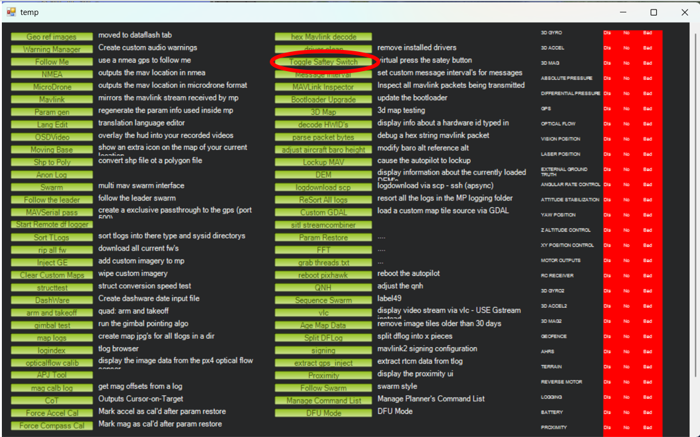
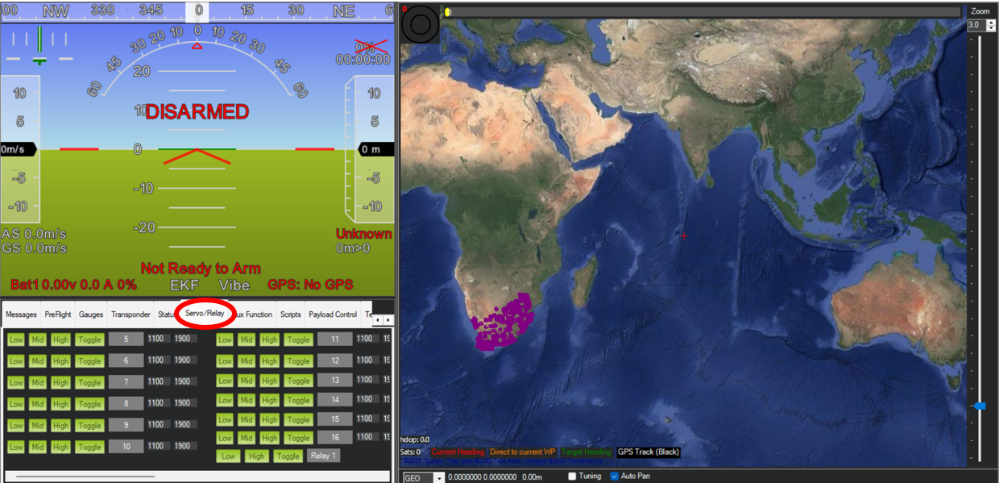
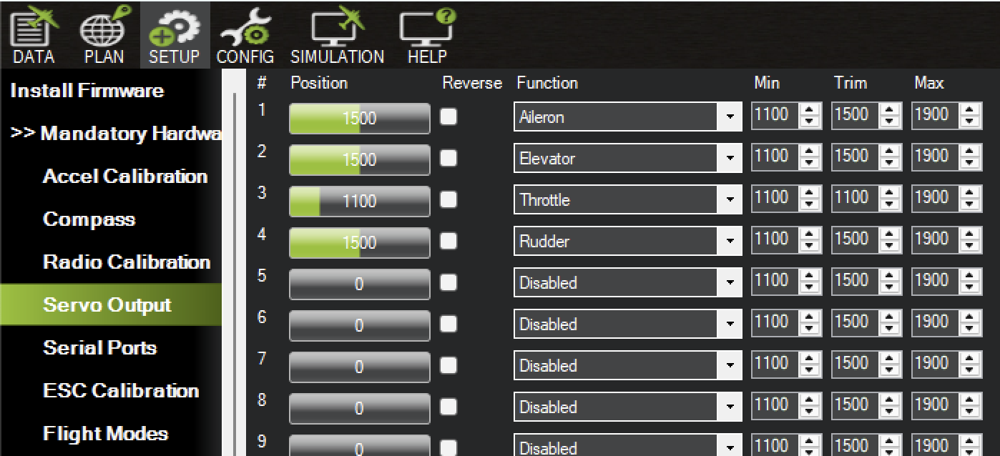
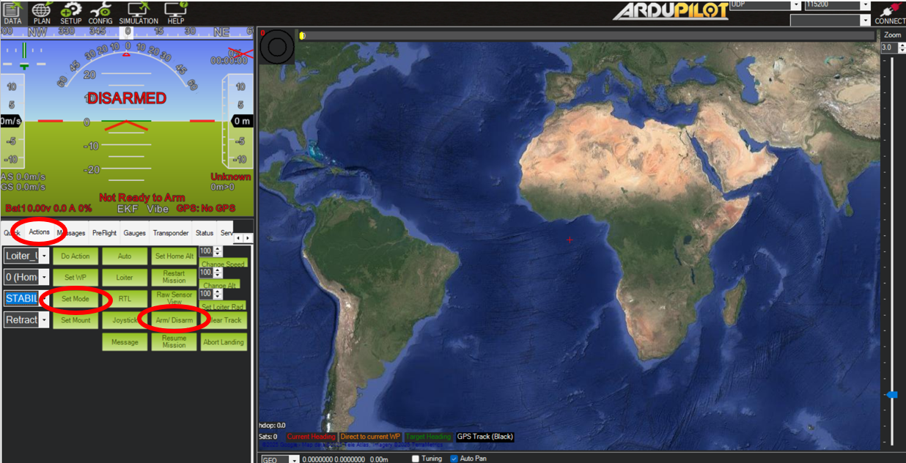
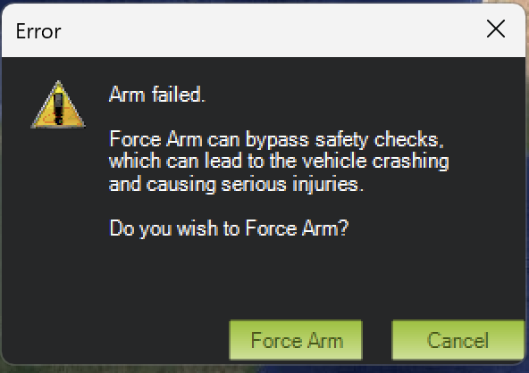

# Controlling Servos via Mission Planner

This page walks you through setting up your system so that you can control a servo manually from Mission Planner's Servo/Relay tab.

!!! info "Minimum hardware requirements"

    Everything here is in your kit; see the [kit list](../kit-list.md) for what each item looks like.

    * Cube Orange+ on its carrier board
    * USB/buzzer cable, and a USB cable to your laptop
    * Power supply (12 V DC) and mains cable
    * Power Brick Mini and POWER2 cable
    * UBEC
    * One servo: a blue 9 g micro servo, or the large black Feetech servo
    * A laptop with Mission Planner installed

!!! info "Start from a freshly flashed Cube"

    These instructions assume a newly flashed Cube. If you run into problems following them, re-flash your Cube to Sub (submarine), then back to Plane. As explained on the [Mission Planner](02-missionplanner.md) page, this makes sure **all** parameters are reset to default: the "Reset to Defaults" button doesn't always do a thorough enough job.

## Connecting the servo

!!! warning "Power servos from the UBEC, not from USB"

    Your laptop's USB port can't supply the current a servo draws, particularly when it stalls. Power the servo rail from the UBEC.

    Servos can draw significant current when 'stalled', i.e. the servo is trying to move but has reached the end of a mechanism's movement. The kit's [9 g micro servos](https://servodatabase.com/servo/feetech/fs90) stall at around 0.8 A each, and the [large Feetech servo](https://servodatabase.com/servo/feetech/ft7135m) up to 4 A (est): its stall current isn't published, so treat that as an estimate and leave yourself margin.

1. **Set the UBEC's output voltage.** Start with 5 V.
2. **Connect the UBEC's output to AUX OUT 1**, at the end of the row, taking care with polarity. All the positive (+) pins are connected to one another, as are all the negative (-) pins, so this one connection powers the whole rail, including MAIN OUT 5.
3. **Plug the servo into MAIN OUT 5**, the right way round:

    * top: negative (-), black (or sometimes brown) wire
    * middle: positive (+), red wire
    * bottom: signal (S), white or orange wire

    Your cable colours may vary, and that's fine: many other colour schemes exist. The polarity is what counts, not the colour.

## Setting the parameters

1. **Connect your Cube** to your laptop with the USB/buzzer cable.
2. **Connect Mission Planner**, choosing `AUTO` in the connection drop-down menu. Mission Planner will detect which COM port to use.
3. **Open the full parameter list**: go to the `CONFIG` tab, then `Full Parameter List`.
4. **Search for each parameter** in the table below, and set it to the value shown.
5. **Write the parameters** with `Write Params`, and reboot if prompted. You can reboot with `reboot pixhawk` in the ++ctrl+f++ menu, or with a power cycle.

| Parameter | Value | Description |
|---|---|---|
| `THR_FAILSAFE` | 0 | The RC transmitter connection failsafe. Disabling it allows us to arm the Cube without an RC receiver connected. |
| `SERVO5_FUNCTION` | 0 | Disables Servo 5's automatic function, allowing us to take manual control. This should be the default. |

## Moving the servo

**Toggle the safety switch.** Press ++ctrl+f++ and click `Toggle Saftey Switch`. This allows a PWM signal to be sent to the servo.

**Open the Servo/Relay tab**, in the bottom left of the `DATA` tab.

You can now use this tab to change the PWM signal being sent to the servo connected to MAIN OUT 5.

!!! note "Check the signal in Servo Output"

    `SETUP` › `Mandatory Hardware` › `Servo Output` shows the PWM signal on each output in its `Position` bar. If output 5 changes when you use the Servo/Relay tab but the servo doesn't move, the signal is leaving the Cube, so check the servo's wiring and power.

    

## Troubleshooting

If the servo doesn't move, work through these in order.

1. **Check the servo is plugged into MAIN OUT 5**, the right way round: see [Connecting the servo](#connecting-the-servo).
2. **Check the servo is getting power from the BEC**, by using a multimeter to test that the MAIN OUT 5 pins are powered.
3. **Reboot the Cube** from Mission Planner.
4. **Power cycle the Cube**: unplug the power, plug it back in, and reconnect Mission Planner.
5. **Try arming the Cube**: in the `DATA` tab, open the `Actions` tab in the bottom left and click `Arm/ Disarm`.

    

    If arming fails, Mission Planner asks whether you want to force arm. Click `Force Arm`, then try controlling the servo again.

    

    !!! warning "Force arming skips the safety checks"

        Force arming tells the Cube to arm even though its pre-arm checks have failed. That's acceptable on the bench with only a servo connected, but never with a motor or propeller attached. Disarm with `Arm/ Disarm` when you've finished.

6. **Re-flash the Cube** to Sub, then back to Plane, and follow the steps on this page again.

Once your servo moves from Mission Planner, you're ready to control it from a script. Head to the next step using the links below or to the left.
