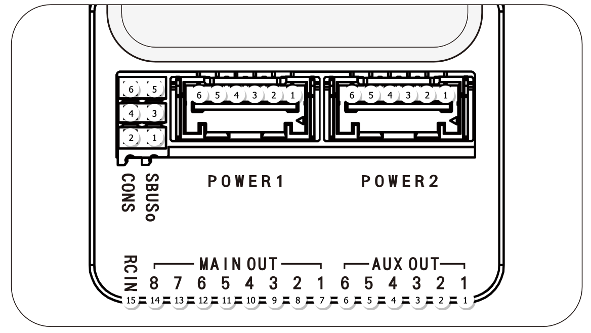

# RC: the transmitter and receiver

The transmitter lets a person move the control surfaces with the sticks. On the rig, that's your safety pilot: someone who can take over from the ground station with one switch. This page gets the transmitter talking to the Cube, then hands control between the sticks and CubeGUI.

!!! danger "Not for flight"

    Everything here is for a model held on a bench or wind-tunnel rig. The hand-over between the sticks and the ground station is not a flight failsafe, and must not be used on anything that flies.

!!! info "Video: RC set-up walkthrough"

    Binding the receiver, the switches, calibrating, and handing over between the sticks and CubeGUI. *(Link coming soon.)*

<!-- CHECK against Robin's video before publishing: every step marked CHECK below. -->

!!! info "What you need"

    * Your Cube set up as on the earlier pages: [Telemetry](03-telemetry.md), [Power](04-power.md) and [Servos](05-servos.md), with a servo on MAIN OUT 5
    * The FrSky Twin X14 transmitter, charged, and the TW MX receiver from your kit (see the [kit list](../kit-list.md))
    * Mission Planner, for the radio calibration
    * CubeGUI at level 2 or above, for handing control over (see [CubeGUI](07-cubegui.md))

## 1. Connect the receiver to the Cube

Plug the receiver's **SBUS output** into the Cube's **RCIN** port: the three pins at the end of the servo rail, next to MAIN OUT 8. The pins are the same way round as on the servo outputs ([Servos](05-servos.md)): signal at the bottom. Not **SBUSo**: that's an output.

<!-- CHECK: which of the TW MX's pins is SBUS out, and whether the kit comes with a ready-made lead. -->
<!-- CHECK: RCIN is powered by the Cube itself (receiver's LED lights with only USB or the power brick connected). -->

The receiver is powered through the same lead. ArduPilot finds out by itself that it's SBUS: there's nothing to set.

## 2. Make a model on the transmitter

A *model* is the transmitter's settings for one aircraft. Make one for your kit, so another group's settings never move your servos.

1. On the transmitter, create a new model: **Plane**, with one channel each for aileron, flap, elevator and rudder.
2. Name it after your kit, e.g. `Kit07`.

<!-- CHECK: the model wizard's menu names on ETHOS, and its default channel order. -->

## 3. Register and bind the receiver

1. On the transmitter, open the model's **RF System** settings, and choose **Register** on the internal module.
2. Power off the Cube. Hold down the button on the receiver, and power the Cube up again while still holding it.
3. On the transmitter, finish **Register**. Then choose **Bind**, and power-cycle the Cube again when it asks.
4. The receiver's light should go steady once it's bound.

<!-- CHECK: exact ETHOS steps and the receiver's LED colours. This follows the guide's cheat sheet (page "More"). -->

You only need to do this once per receiver. If you swap receivers between kits, do it again.

## 4. Put two switches on spare channels

You need two switches, each on a channel that no stick uses:

| Switch | What it does | Kind |
|---|---|---|
| **Mode switch** | Hands the servos between the sticks and the ground station | Three-position |
| **SAS switch** | Pitch damping while the sticks have control (level 3, optional for now) | Three-position, or two |

In the transmitter's **Mixes**, add a mix for each switch, with the switch as its source and a spare channel as its output: channels 7 and 8 work if your model uses 1 to 6.

<!-- CHECK: ETHOS menu names for adding a switch mix; which switches the X14 has. -->

Write down which switch went on which channel. You'll need the numbers in step 7.

## 5. Set the receiver's failsafe to "No pulses"

When the receiver loses the transmitter's signal, it should stop sending anything. Then the Cube can tell the signal has gone, and stop using the sticks.

In the model's **RF System** settings, set **Failsafe** to **No pulses**.

<!-- CHECK: ETHOS's failsafe menu and option name. -->

!!! warning "Not \"Hold\""

    With **Hold**, the receiver keeps sending the last stick positions when the signal goes. The Cube can't tell anything is wrong, so the surfaces stay wherever the sticks were.

## 6. Calibrate the radio in Mission Planner

ArduPilot needs to know each channel's range: the Cube reads a stick's position relative to it.

1. Connect Mission Planner to the Cube.
2. Go to **Setup** > **Mandatory Hardware** > **Radio Calibration**.
3. Click **Calibrate Radio**, then move every stick and switch to both ends, several times.
4. Click **Click when Done**.

While you're there, check that:

* each stick moves the bar you expect;
* each switch moves its own channel, going **below about 1200** at one end and **above about 1800** at the other.

Then close Mission Planner before connecting CubeGUI.

* [:material-information:ArduPilot - radio control calibration](https://ardupilot.org/plane/docs/common-radio-control-calibration.html)

## 7. Hand control between the sticks and CubeGUI

This uses CubeGUI's Lua script, `cubegui.lua`, at **level 2**. The [cubegui.lua README](https://github.com/AVDASI2/CubeGUI/blob/main/lua/README.md) has every parameter, and troubleshooting.

!!! warning "One script, not two"

    `cubegui.lua` replaces `avdasi2.lua` from the [Mode switch](06c-mode-switch.md) page: they use the same switches, and would fight over the servos. If `avdasi2.lua` is in `APM/scripts`, delete it and reboot. CubeGUI's Setup tab tells you if it's still running.

1. **Start CubeGUI at level 2 and connect.** Over the Wi-Fi or a USB cable.
2. **Turn on scripting.** In the **Setup** tab, `SCR_ENABLE` shows "Needs changing". Click **Apply changes...**, confirm, then **Reboot now**.
3. **Copy the script.** In the Setup tab's **cubegui.lua on the Cube** box, click **Copy cubegui.lua to the Cube...** and confirm. On the **Run** tab, **Who's in charge** should say "Script running" within a few seconds.
4. **Find your channels.** On the Run tab, the **RC transmitter** panel shows each channel as a bar. Move each stick and switch, and note which bar moves.
5. **Tell the Cube which switch is which.** In the Setup tab, type the mode switch's `RCn_OPTION` in **Add parameter** (`n` is its channel, e.g. `RC7_OPTION`) and set it to **300**. Do the same for the SAS switch with **301**. Apply the changes.
6. **Check the sticks.** By default the elevator stick (channel 2) drives MAIN OUT 5, and the rudder stick (channel 4) drives MAIN OUT 6. If your sticks are on other channels, change `CGUI_M1_RC` (for output 5) and `CGUI_M2_RC` (for output 6) to match.

### Try it

| Mode switch | Who drives the servos |
|---|---|
| **Low** | The sticks. CubeGUI's sliders grey out. |
| **Middle** | No change |
| **High** | CubeGUI's sliders, as before |

**Then test losing the signal.** With the mode switch low, turn the transmitter off. Within a few seconds, **Who's in charge** should say "RC: none", and CubeGUI should have the servos back. This needs `THR_FAILSAFE` at 1 (ArduPlane's default) or 2: the Setup tab checks it. If the servos stay on the last stick positions instead, go back to step 5.

## Troubleshooting

* **No bars move** in the radio calibration or the RC transmitter panel: check the receiver's light (step 3) and that it's in RCIN, not SBUSo (step 1).
* **The mode switch does nothing:** check `RCn_OPTION = 300` is on the channel whose bar moves, and that the switch goes below 1200 and above 1800 (step 6).
* **A stick moves the wrong servo, or none:** check `CGUI_M1_RC` and `CGUI_M2_RC` (step 7.6).
* **A surface moves the wrong way:** set `SERVOn_REVERSED` to 1 for that output.
* **"no script heard"** in CubeGUI: see the [cubegui.lua README](https://github.com/AVDASI2/CubeGUI/blob/main/lua/README.md#troubleshooting).

* [:material-information:ArduPilot - RC systems](https://ardupilot.org/plane/docs/common-rc-systems.html)
* [:material-information:FrSky TW MX receiver](https://www.frsky-rc.com/product/tw-mx/)
* [:material-information:FrSky Twin X14 transmitter](https://www.frsky-rc.com/twin-x14-x14s/)
