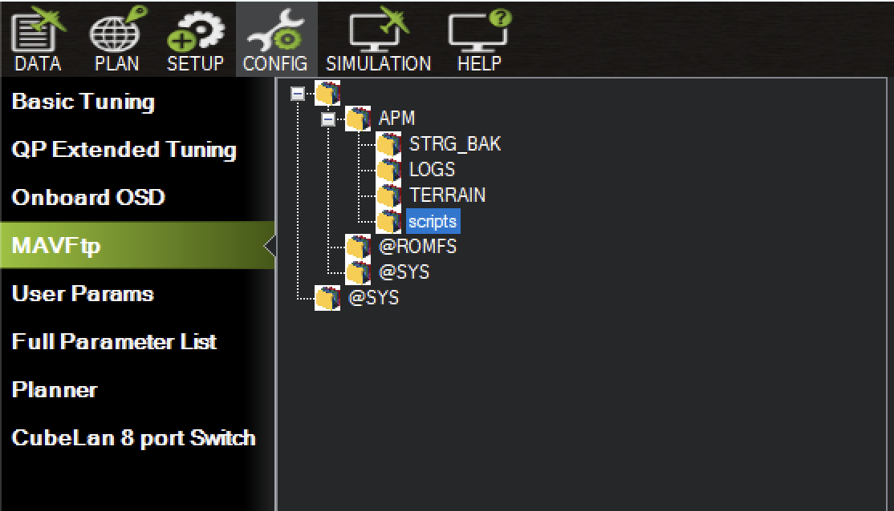

# Controlling Servos Using a Lua Script

This page walks you through setting up your system so that you can control a servo from a Lua script running on the Cube. It assumes you can already move your servo from Mission Planner's Servo/Relay tab: if not, go back to [Servos via Mission Planner](05-servos.md) first.

<!-- in-progress:start -->
!!! abstract "Draft notes: remove before publishing"

    * The Servo Output screenshot is shared with page 05 (`assets/servo_output-MP.png`).
<!-- in-progress:end -->

We'll use one of ArduPilot's own example scripts, [:material-information:`servo_slew.lua`](https://github.com/ArduPilot/ardupilot/blob/master/libraries/AP_Scripting/examples/servo_slew.lua). It moves a servo back and forth in a smooth sine wave, and it creates its own parameters so you can change how it moves from Mission Planner. The [next page](06b-lua-servo-explained.md) goes through how it works.

!!! info "No arming needed"

    You don't need to arm the Cube for this. You do need to toggle the safety switch from the ++ctrl+f++ menu, as on the previous page.

## Enabling scripting

1. **Connect Mission Planner**, and open the full parameter list: the `CONFIG` tab, then `Full Parameter List`.
2. **Search for `SCR_ENABLE`** and set it to 1.
3. **Write the parameters** with `Write Params`.
4. **Reboot the Cube**, with `reboot pixhawk` in the ++ctrl+f++ menu or with a power cycle.

Rebooting with scripting enabled creates a `scripts` folder inside the `APM` folder on the Cube's SD card. If it doesn't appear, create it yourself.

## Uploading the script

:material-download: [servo_slew.lua](assets/servo_slew.lua)

??? example "The script, `servo_slew.lua`"

    ```lua
    --8<-- "docs/avionics/stepbystep/assets/servo_slew.lua"
    ```

1. **Open MAVFtp**: the `CONFIG` tab, then `MAVFtp`. This lets you see the files on the Cube's SD card.
2. **Open the `scripts` folder**: open the top folder, which has no name, then `APM`, then `scripts`.

    

3. **Upload the script**: right-click in `scripts`, choose `Upload`, and find `servo_slew.lua` on your laptop.
4. **Reboot the Cube.** Scripts in `APM/scripts` start automatically every time the Cube boots.

## Setting the script's parameters

When the script runs for the first time it creates five new parameters, all starting with `STEST_`. To see them, go back to `Full Parameter List` and click `Refresh Params`, then search for `STEST`.

| Parameter | Default | What it does |
|---|---|---|
| `STEST_CHAN` | 0 | The servo output the script drives. 0 means off. |
| `STEST_PCT` | 100 | How far the servo swings, as a percentage of the full range. |
| `STEST_PWM_MIN` | 1000 | The PWM signal at one end of the swing. |
| `STEST_PWM_MAX` | 2000 | The PWM signal at the other end. |
| `STEST_FREQ` | 1 | How many full swings per second. |

**Set `STEST_CHAN` to 5**, to match the MAIN OUT pins your servo is plugged into, and write the parameters. `SERVO5_FUNCTION` must still be 0, as on the previous page.

!!! warning "Mind the end stops"

    By default the script swings the servo across its full range. If your servo is fitted to a mechanism, that may drive it into the end of its travel and stall it. Reduce `STEST_PCT`, or bring `STEST_PWM_MIN` and `STEST_PWM_MAX` closer together, before you connect anything to the servo horn.

These parameters are saved on the Cube, so they survive reboots and edits to the script.

## Watching it run

**Toggle the safety switch**: press ++ctrl+f++ and click `Toggle Saftey Switch`. Your servo should now sweep back and forth, once a second.

!!! note "Check the signal in Servo Output"

    `SETUP` › `Mandatory Hardware` › `Servo Output` shows the PWM signal on each output in its `Position` bar. With the default settings, output 5 should move through one full cycle between high and low every second.

    

To stop the script moving the servo, set `STEST_CHAN` back to 0.

## Troubleshooting

If the servo doesn't move, work through these in order.

1. **Check the servo moves from the Servo/Relay tab**, as on the [previous page](05-servos.md). If it doesn't, the problem isn't the script: follow that page's troubleshooting.
2. **Check the script is running.** Look in the `Messages` tab, in the bottom left of the `DATA` tab, for any message mentioning Lua. An error there names the script and the line it failed on.
3. **Check the `STEST_` parameters exist.** If they don't appear after `Refresh Params`, the script hasn't run: check `SCR_ENABLE` is 1, the file is in `APM/scripts`, and you've rebooted since uploading it.
4. **Check `STEST_CHAN` is 5** and `SERVO5_FUNCTION` is 0.
5. **Check the safety switch** has been toggled since the last reboot.
6. **Check `Servo Output`**, as above. If output 5 is changing but the servo isn't moving, check the servo's wiring and power.
7. **Try arming the Cube**, as on the [previous page](05-servos.md).

## Recap

1. `SCR_ENABLE` = 1, write the parameters, and reboot.
2. Upload `servo_slew.lua` to `APM/scripts`, and reboot.
3. Refresh the parameters, set `STEST_CHAN` = 5, and write the parameters.
4. Toggle the safety switch.
5. If it isn't working, check `Servo Output`, then try arming.

Once your servo is moving under the script's control, head to the next page to see how the script works.
