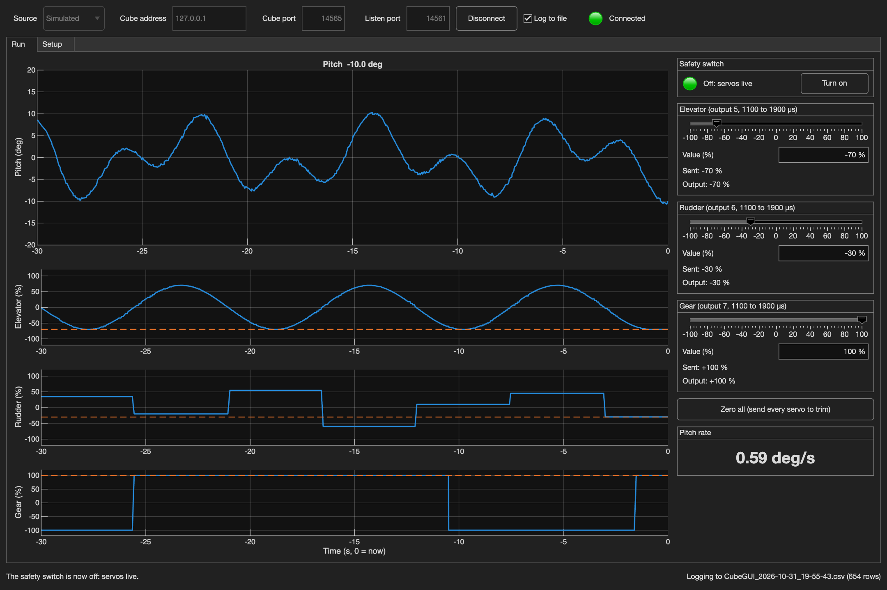

# CubeGUI: a ground station in MATLAB

CubeGUI is a MATLAB window for bench and wind-tunnel testing with your Cube: live plots of pitch and the servos, sliders to move the control surfaces, logs of everything, and a Setup tab that checks the Cube's parameters for you and can flash ArduPlane onto it over USB. It's a tool of its own, with its own documentation and videos. This page tells you where to find them.

!!! danger "Not for flight"

    CubeGUI has been lightly tested, on ArduPilot's simulator and on the bench. It's suitable for careful wind-tunnel and bench testing of a model held on a rig, and **not** for anything that flies. It was written with the help of an AI assistant; its README says how.



!!! info "Before you start"

    * Your Cube set up as on the earlier pages: [Telemetry](03-telemetry.md), [Power](04-power.md) and [Servos](05-servos.md)
    * MATLAB R2026a or later, with **UAV Toolbox** (install it from the Add-On Explorer)
    * A laptop joined to your kit's Wi-Fi (`AVDASI2 - Kit X`), or a USB cable to the Cube (USB needs MATLAB R2026b or later), with Mission Planner closed

## Getting started

1. Get it from GitHub, ideally with git so you can update it with one command:

    ```bash
    git clone https://github.com/AVDASI2/CubeGUI.git
    ```

    (Or **Code** > **Download ZIP**.)

2. Watch the introduction videos (coming soon).
3. Read the [README](https://github.com/AVDASI2/CubeGUI#readme). It covers running it, connecting to your Cube, logging, and changing CubeGUI to suit your team.

You can try it straight away with no hardware: type `CubeGUI` in MATLAB, choose **Simulated**, and click **Connect**.

## Levels

CubeGUI's features arrive in stages as the unit goes on. **Levels 0 (Simulate) and 1 (Connect and log, over the Wi-Fi or a USB cable) are released.** Levels 2 (RC) and 3 (Closed loop) are previews: they're in the code to look at, but aren't supported until they're released later in the unit.

!!! tip "On a Mac"

    Mission Planner's Mac build can't flash firmware (see [Mission Planner](02-missionplanner.md)). CubeGUI can, over a USB cable: **Setup** tab > **Firmware over USB** > **Flash ArduPlane...**. Its **Reset to a fresh Cube...** does the same job as flashing Sub then Plane. You'll still need a ground station for the calibrations on the earlier pages.

## Other ways to talk to the Cube

CubeGUI isn't the only option. **Mission Planner** does almost everything, including the calibrations on the earlier pages, which CubeGUI can't do. **[PyMAVLink](08-pymavlink.md)** lets you write your own ground station in Python. CubeGUI sits in between: one window built for this test, that you can change without starting from scratch.
