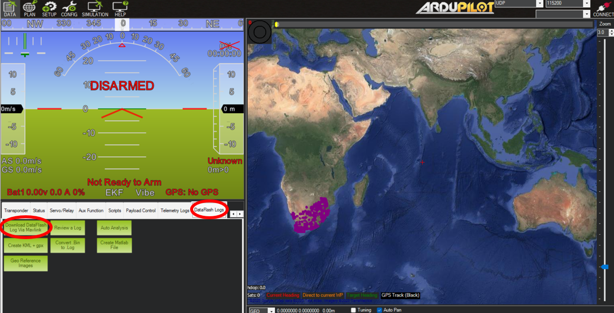
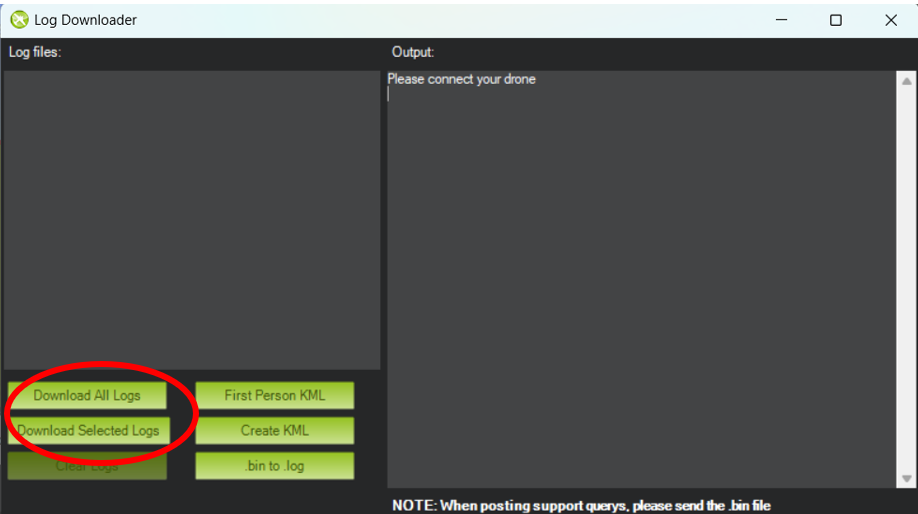
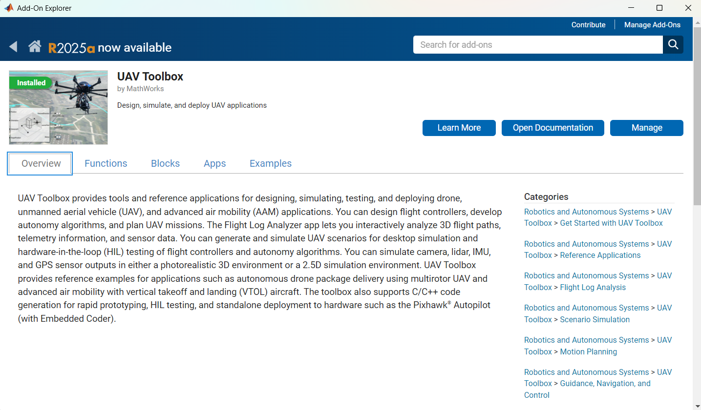
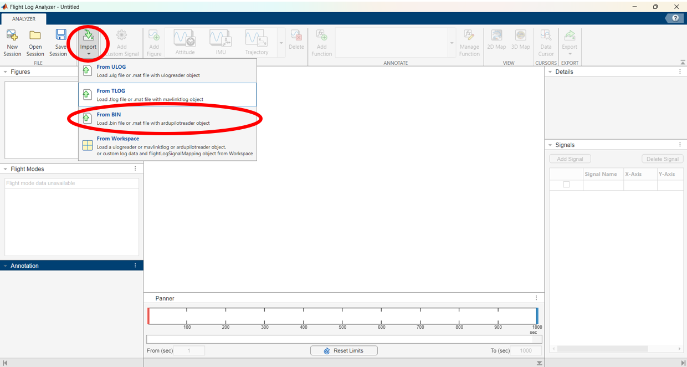
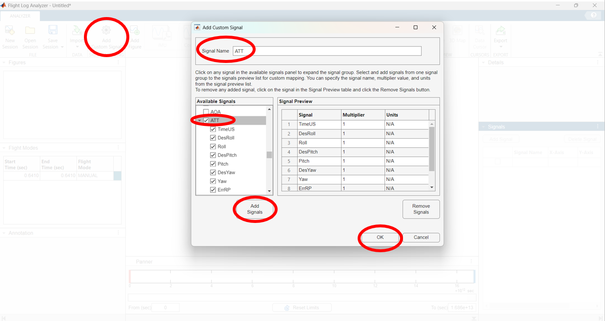
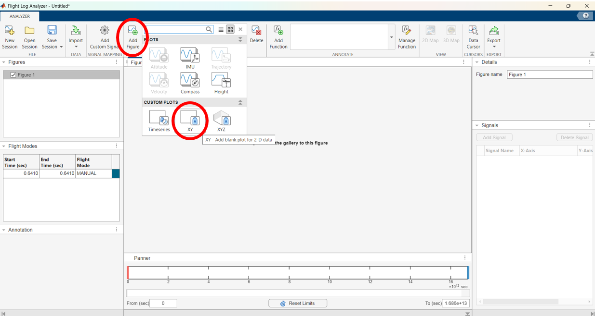
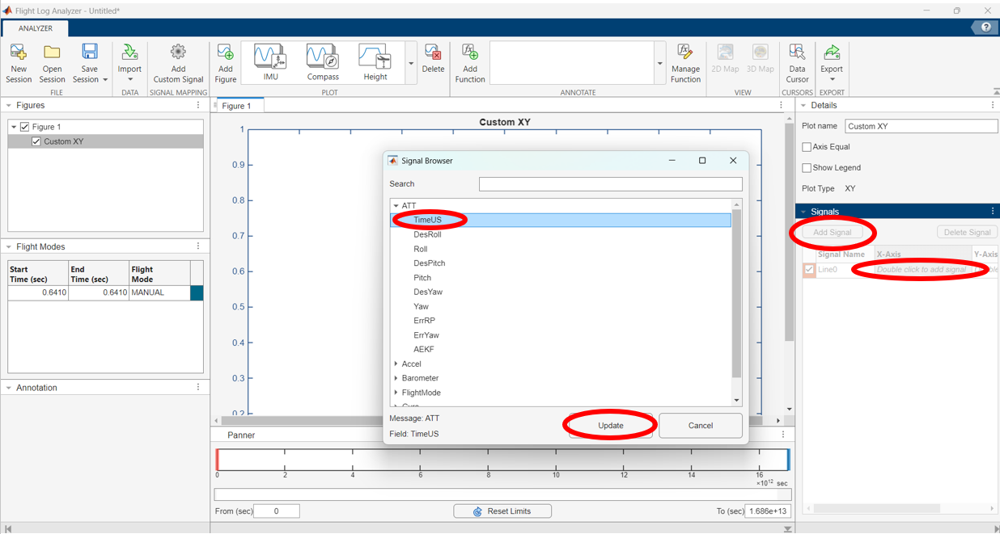
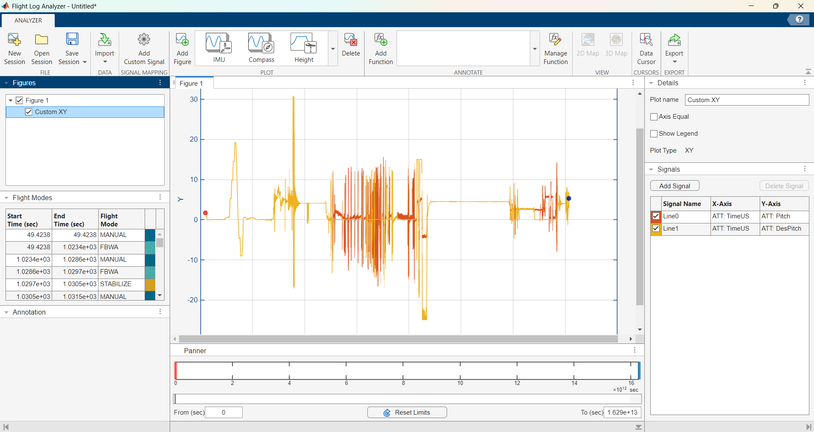

# Data Logging

## Recording a log

The Cube can keep a detailed log of all its sensors (IMUs, temperature sensors, etc.), its attitude and its servo outputs, as a `.BIN` file on its SD card. You'll want one for each wind-tunnel test, so that the Company's subteams can analyse the data.

!!! info "Logging on the bench: `LOG_DISARMED`"

    By default the Cube only logs while it's armed. You never need to arm it on the bench or in the tunnel, so instead set `LOG_DISARMED` to 1 in the `Full Parameter List` and write the parameters. The Cube then logs from the moment it powers up. Set it back to 0 to stop.

    The Cube saves this setting, so it carries on logging after a reboot until you set it to 0.

Logs are big: about 3 MB for every minute of logging. Only log while you're testing, and download what you need before the next session.

!!! tip "Optional: if you're using CubeGUI"

    CubeGUI, the course's MATLAB ground station, has a Logs panel that starts and stops the Cube's log for you (it changes `LOG_DISARMED`, and asks first), and adds your run markers to it, so each run is easy to find. You don't need it: everything on this page works without it.

## Downloading Cube logs {#downloading-cube-logs}

Leave the SD card in the Cube, and download the logs with Mission Planner over USB:

1. Plug the Cube into your laptop with the USB cable, and connect Mission Planner.
2. In the `DATA` tab, open `DataFlash Logs` and click `Download DataFlash Log Via Mavlink`.

!!! tip "You can also view a selected .bin file directly with the `Review a Log` button"

This opens the `Log Downloader` menu, showing all the available log files, which you can download from here.

!!! warning "Downloading over Wi-Fi is very slow"

    Over the Kahuna's Wi-Fi, a download runs at about 4 kB a second, so each minute of logging takes about 12 minutes to download (timed on a kit, November 2026). Use USB for anything but a very short log.

## Optional: Logging through Lua scripts

Lua scripts can write their own values into the Cube's log with `logger:write`, so they sit alongside everything else in the `.BIN` file. They can also create and modify files on the Cube's SD card (for example, saving flap angles from a sensor into a CSV). Keep this to a few values, as writing files takes processing time on the flight controller. The example scripts will showcase this as well.

## MATLAB data analysis

A useful tool to analyse the Cube logs is the `Flight Log Analyzer` app built into MATLAB.

To access the app you first need to install MATLAB's `UAV Toolbox` from the Add-On Explorer.

After opening the `Flight Log Analyzer` app, click import to import the .bin file you downloaded (see [Downloading Cube logs](#downloading-cube-logs)).

!!! note "It may take a while for large .bin files to load"

The next step is adding the desired signals you want to analyse. This is done by clicking the `Add Custom Signal` button. This will open the `Add Custom Signal` menu with a list of all the signals that the cube logged. 

!!! tip "The most relevant signal is `ATT`"
    This stands for "Attitude" which will give you the pitch/roll/yaw and other relevant data. 

    Make sure to include the `TimeUS` signal since this will give you timestamps.

Once you've selected your signals, click `Add Signals` and they'll appear in the `Signal Preview` box. 

!!! note "You must name your signal before it lets you click `OK`"

!!! tip "Feel free to explore the other available signals"
    Lots of cool post-processing can be done!

Next click the `Add Figure` button to create a Figure. In the `PLOTS` dropdown menu, the `XY` custom plot is the most useful. Click on it to create a plot.

Finally, to plot signals into your figure, click the `Add Signal` button. A new line should appear. Double clicking on either the X or Y axis box in the table will open up the `Signal Browser` menu where you can select one of your previously added custom signals.

The image below shows the final result of the Pitch and Desired Pitch vs Time for a Fuselage test switching between the Cube's `Manual` and `Stabilize` mode and messing with the PD variables.

