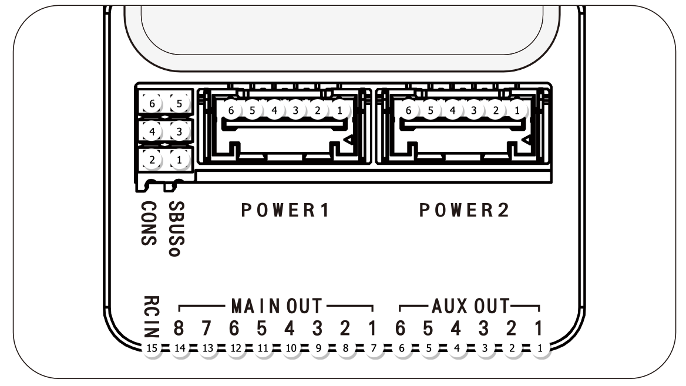

# RC: the transmitter and receiver

The transmitter lets a person move the control surfaces with the sticks. On the rig, that's your safety pilot: someone who can take over from the ground station with one switch. This page gets the transmitter talking to the Cube, then hands control between the sticks and CubeGUI.

!!! danger "Not for flight"

    Everything here is for a model held on a bench or wind-tunnel rig. The hand-over between the sticks and the ground station is not a flight failsafe, and must not be used on anything that flies.

The walkthrough video (plugging in, registering and binding the receiver, the switches, and handing over between the sticks and CubeGUI) is coming soon.

<!-- VIDEO: to embed it, replace VIDEO_ID with the YouTube ID, uncomment the block,
     and delete the "coming soon" line above. Same style as the CubeGUI page.

<iframe src="https://www.youtube-nocookie.com/embed/VIDEO_ID?rel=0&amp;modestbranding=1"
        title="RC set-up walkthrough"
        allow="accelerometer; clipboard-write; encrypted-media; gyroscope; picture-in-picture; fullscreen"
        allowfullscreen loading="lazy"></iframe>

-->

!!! info "What you need"

    * Your Cube set up as on the earlier pages: [Telemetry](03-telemetry.md), [Power](04-power.md) and [Servos](05-servos.md), with a servo on MAIN OUT 5
    * The FrSky Twin X14 transmitter, charged, and the TW MX receiver from your kit (see the [kit list](../kit-list.md))
    * CubeGUI at level 2 or above, for handing control over (see [CubeGUI](07-cubegui.md))

## 1. Plug the receiver into the Cube

The receiver's lead has six wires: black, red, yellow, green, white and blue. The Cube needs three of them, in a 3-pin plug: **black** (ground), **red** (power) and **white** (SBUS, the signal from the receiver).

!!! warning "Check your plug has the white wire, not the yellow"

    Some kits' plugs have the yellow wire in them instead of the white. If yours does, swap them: lift the plug's small plastic latch over the yellow wire's pin, slide the pin out, and push the white wire's pin into the same place until it clicks. Ask if you're not sure.

Plug it into the Cube's **RCIN** port: the three pins at the end of the servo rail, next to MAIN OUT 8. The pins are the same way round as on the servo outputs ([Servos](05-servos.md)): signal at the bottom. Not **SBUSo**: that's an output.

The Cube powers the receiver through the same lead: its light comes on even with only the USB cable connected. ArduPilot finds out by itself that it's SBUS: there's nothing to set.

## 2. Make a model on the transmitter

A *model* is the transmitter's settings for one aircraft. Make one for your kit, so another group's settings never move your servos.

1. Open **Model select**, click **+**, then **Create model**, and choose **Airplane**.
2. When it asks if you're using a self-stabilising receiver from FrSky, answer **No**.
3. Choose **no flaps**, **1 aileron channel** (the default is 2), **1 elevator channel**, **1 engine channel** and **1 rudder channel**, and the default tail. This leaves channels 5 and 6 free for the switches.
4. Name it after your kit, e.g. `Kit07`. The picture is up to you.

## 3. Register the receiver

1. On the transmitter, open the model's **RF System** settings. If the internal module is off, turn it on in its drop-down.
2. Choose **Register** on the internal module.
3. Power off the Cube. Hold down the button on the receiver, and power the Cube up again while still holding it. The receiver's light shows green and red: it's ready to register.
4. On the transmitter, finish **Register**.

## 4. Bind the receiver

1. Still in **RF System**, click one of the receiver slots, **RX1**, **RX2** or **RX3**. **Bind** only appears once you've clicked one.
2. Click **Bind**, and power-cycle the Cube when it asks.
3. Once it's bound, the receiver's light is green only.

You only need to do this once per receiver. If you swap receivers between kits, do it again.

## 5. Put two switches on channels 5 and 6

You need two switches, each on a channel that no stick uses:

| Switch | Transmitter switch | Channel | What it does |
|---|---|---|---|
| **Mode switch** | SA | 5 | Hands the servos between the sticks and the ground station |
| **SAS switch** | SB | 6 | Pitch damping while the sticks have control (level 3, optional for now) |

SA to SD are three-position switches. Don't use **SE**: it springs back by itself. SF is a two-position switch.

For each switch, add a mix:

1. Go to **Model** > **Mixes**, click on an existing mix, then **Add**.
2. Choose **Free Mix**, then **Last Position**.
3. Open **Source**, and flick the switch you want: it's selected automatically. Press the **RTN** button.
4. In **Output1**, choose **CH5** (or **CH6**) from the drop-down, and press **RTN**.

Other spare channels work too, but **not channel 8**: ArduPlane uses it for flight modes (`FLTMODE_CH`).

## 6. Hand control between the sticks and CubeGUI

This uses CubeGUI's Lua script, `cubegui.lua`, at **level 2**. The [cubegui.lua README](https://github.com/AVDASI2/CubeGUI/blob/main/lua/README.md) has every parameter, and troubleshooting.

!!! warning "One script, not two"

    `cubegui.lua` replaces `avdasi2.lua` from the [Mode switch](08a-mode-switch.md) page: they use the same switches, and would fight over the servos. If `avdasi2.lua` is in `APM/scripts`, delete it and reboot. CubeGUI's Setup tab tells you if it's still running.

1. **Start CubeGUI at level 2 and connect.** Over the Wi-Fi or a USB cable.
2. **Turn on scripting.** In the **Setup** tab, `SCR_ENABLE` shows "Needs changing". Click **Apply changes...**, confirm, then **Reboot now**.
3. **Copy the script.** In the Setup tab's **cubegui.lua on the Cube** box, click **Copy cubegui.lua to the Cube...** and confirm. On the **Run** tab, **Who's in charge** should say "Script running" within a few seconds.
4. **Check your channels.** On the Run tab, the **RC transmitter** panel shows each channel as a bar. Move each stick and switch, and check which bar moves. Each switch should go below about 1200 at one end and above about 1800 at the other.
5. **Tell the Cube which switch is which.** In the Setup tab, type `RC5_OPTION` in **Add parameter** and set it to **300** (the mode switch). Do the same with `RC6_OPTION` and **301** (the SAS switch). Apply the changes.
6. **Check the sticks.** By default the elevator stick (channel 2) drives MAIN OUT 5, and the rudder stick (channel 4) drives MAIN OUT 6. If your sticks are on other channels, change `CGUI_M1_RC` (for output 5) and `CGUI_M2_RC` (for output 6) to match.

### Try it

| Mode switch | Who drives the servos |
|---|---|
| **Low** | The sticks. CubeGUI's sliders grey out. |
| **Middle** | No change |
| **High** | CubeGUI's sliders, as before |

## Before the tunnel: good practice

The steps above are enough to hand control over on the bench. These make it dependable, and you'll want them before the model is in the tunnel.

### Calibrate the radio in Mission Planner

**For full, centred stick travel, you need this.** The script reads each stick's position relative to the range ArduPilot has stored for that channel (`RCn_MIN`, `RCn_TRIM` and `RCn_MAX`). Until you calibrate, those are ArduPilot's defaults, so a stick may not reach the servo's full travel, or may not centre at `SERVOn_TRIM`.

1. Connect Mission Planner to the Cube (close CubeGUI first).
2. Go to **Setup** > **Mandatory Hardware** > **Radio Calibration**.
3. Click **Calibrate Radio**, then move every stick and switch to both ends, several times.
4. Click **Click when Done**.

* [:material-information:ArduPilot - radio control calibration](https://ardupilot.org/plane/docs/common-radio-control-calibration.html)

### Set the receiver's failsafe to "No pulses"

**For the sticks to let go when the transmitter's signal is lost, you need this.** When the receiver loses the signal, it should stop sending anything. Then the Cube can tell the signal has gone, and `cubegui.lua` stops using the sticks and hands the servos back to CubeGUI.

In the model's **RF System** settings, set **Failsafe** to **No pulses**.

!!! warning "Not \"Hold\""

    With **Hold**, the receiver keeps sending the last stick positions when the signal goes. The Cube can't tell anything is wrong, so the surfaces stay wherever the sticks were.

**Then test it.** With the mode switch low, turn the transmitter off. Within a few seconds, **Who's in charge** should say "RC: none", and CubeGUI should have the servos back. This also needs `THR_FAILSAFE` at 1 (ArduPlane's default) or 2: the Setup tab checks it. If the servos stay on the last stick positions instead, check the failsafe setting.

## Troubleshooting

* **No bars move** in the RC transmitter panel: check the receiver's light is green only (step 4), that its plug has the white wire, and that it's in RCIN, not SBUSo (step 1).
* **The mode switch does nothing:** check `RC5_OPTION = 300` is on the channel whose bar moves, and that the switch goes below 1200 and above 1800 (step 6.4).
* **A stick moves the wrong servo, or none:** check `CGUI_M1_RC` and `CGUI_M2_RC` (step 6.6).
* **A stick doesn't reach the servo's full travel:** calibrate the radio (above).
* **A surface moves the wrong way:** set `SERVOn_REVERSED` to 1 for that output.
* **"no script heard"** in CubeGUI: see the [cubegui.lua README](https://github.com/AVDASI2/CubeGUI/blob/main/lua/README.md#troubleshooting).

* [:material-information:ArduPilot - RC systems](https://ardupilot.org/plane/docs/common-rc-systems.html)
* [:material-information:FrSky TW MX receiver](https://www.frsky-rc.com/product/tw-mx/)
* [:material-information:FrSky Twin X14 transmitter](https://www.frsky-rc.com/twin-x14-x14s/)
